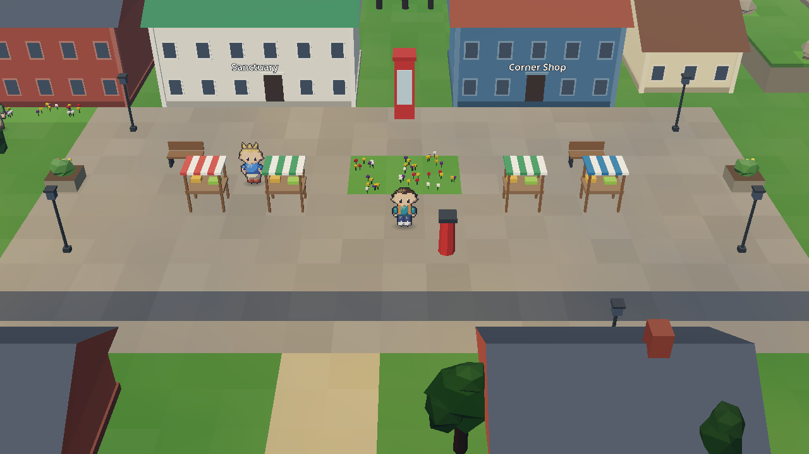
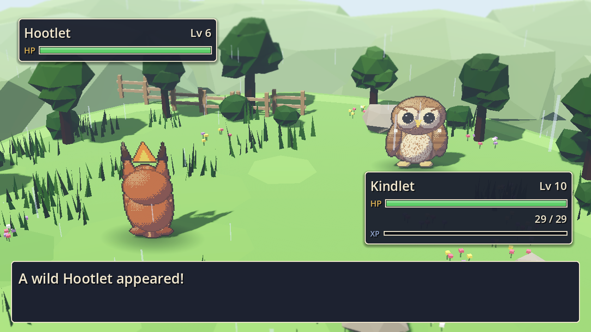
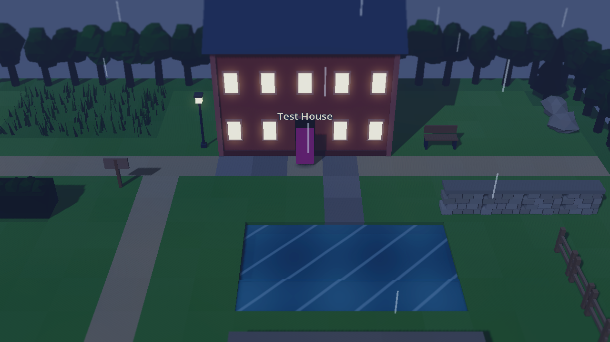
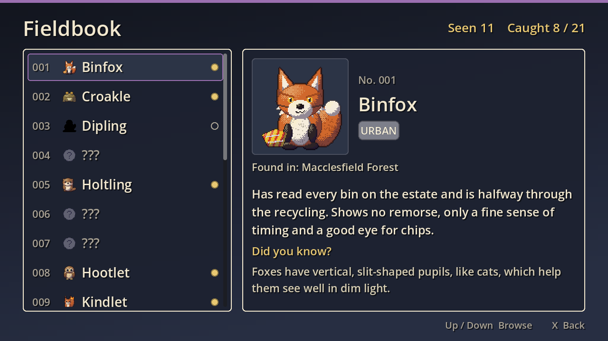
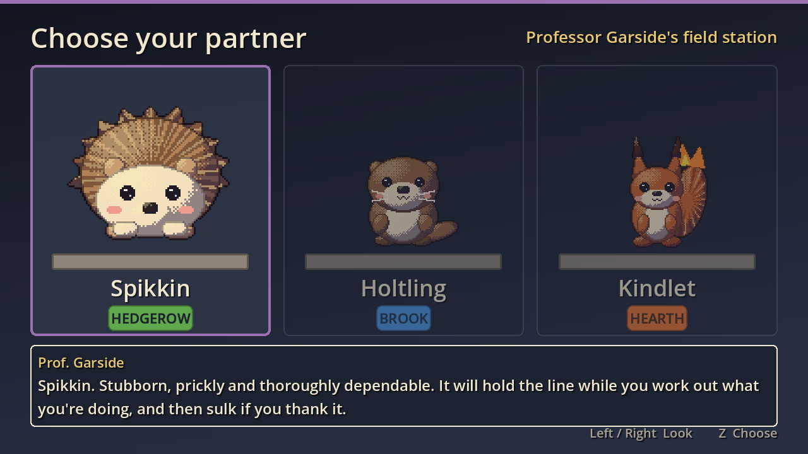
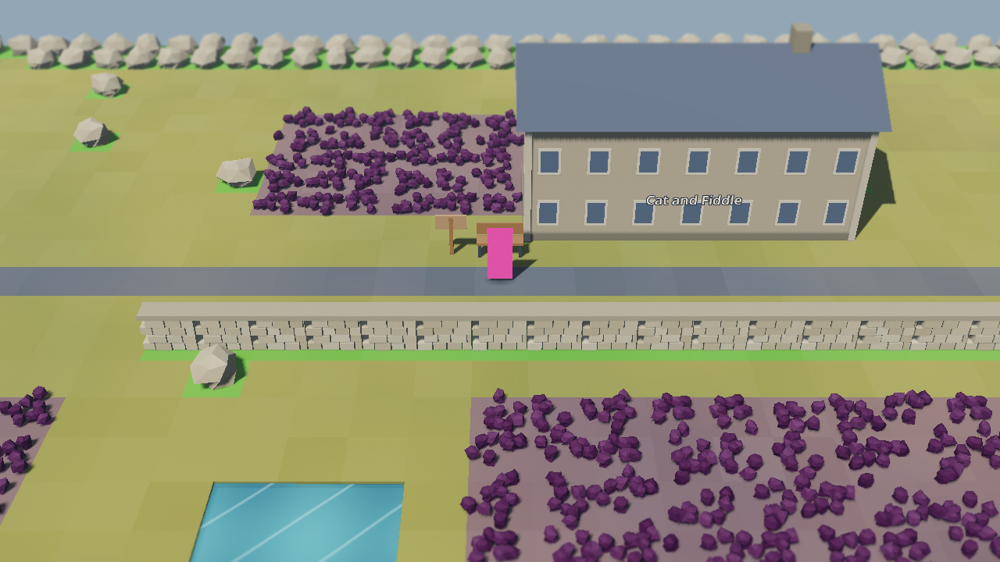

# Wildlore

[](https://github.com/orchardroot/wildlore/actions/workflows/ci.yml)

A monster-catching RPG across the UK and Ireland. You start in Macclesfield, because somebody has to, and the plan is forty towns, ten Keepers and two hundred creatures, most of which you could see on a decent walk if you got up early enough. The rest are legends, and the legends are waking up.


## What's in v0.1, the slice

The first chapter, start to finish: wake up at home, meet Professor Garside at the Field Station, pick a partner, lose to your best mate Kit (or don't), walk Macclesfield Forest and the Cat and Fiddle road over the moor to Buxton, and take the Brook Stone off Keeper Maud at the spa.

- Four zones and seven interiors, built as little low-poly dioramas with pixel-art people in them
- 21 creatures, each with a real fact about the animal (or the folklore) it's based on
- British weather that matters in battle: drizzle, downpour, fog, gale, frost, and the rare and celebrated sunshine
- Day and night, trainers who spot you from across a field, Sanctuaries, Corner Shops, a Fieldbook
- Folk-ish music and sound, synthesised from scratch, because I couldn't play the fiddle and neither can the computer, but it tries

| | |
|---|---|
|  |  |
|  |  |
|  |  |

## Controls

| Action | Keyboard | Gamepad |
|---|---|---|
| Move | Arrows or WASD | D-pad or left stick |
| Run | Shift (hold) | X / West |
| Confirm / talk | Z, Enter or Space | A / South |
| Back | X or Backspace | B / East |
| Menu | Esc or Tab | Start |

## Playing it

Grab the Mac or Windows zip from [Releases](../../releases). The builds aren't signed, so on a Mac right-click Wildlore.app and choose Open the first time; on Windows click "More info" then "Run anyway". It runs at 60 fps on my 2013 iMac, so it'll be fine on yours.

From source: install nothing, run `tools/get_godot.sh` (it fetches the pinned Godot 4.7.2), then open the project with that binary.

## How it's made

Godot 4, GDScript, the Compatibility renderer. Everything is generated: the 3D world is built from text maps by `world/zone_builder.gd`, the creature and character sprites are drawn by `tools/spritegen.gd` from JSON recipes, and the music is composed as note lists in `tools/music/`. No downloaded art or audio.

```
tools/test.sh              # 290-odd unit tests plus the data validator
tools/playtest.sh slice 2  # a headless bot plays the whole slice and must win the Stone
tools/playtest.sh fuzz 7 600   # random walking, talking and battling, looking for soft-locks
```

CI runs the tests and the bot on every push, and three fuzz runs every night. Design and plans live in `docs/superpowers/`.

## Status

Milestone M1 (vertical slice) is done. Next: England North and Wales. The board is [here](https://github.com/users/orchardroot/projects/2).

*orchardroot, made in Cheshire, under the supervision of two cats. Neither of them is in this one. Yet.*
