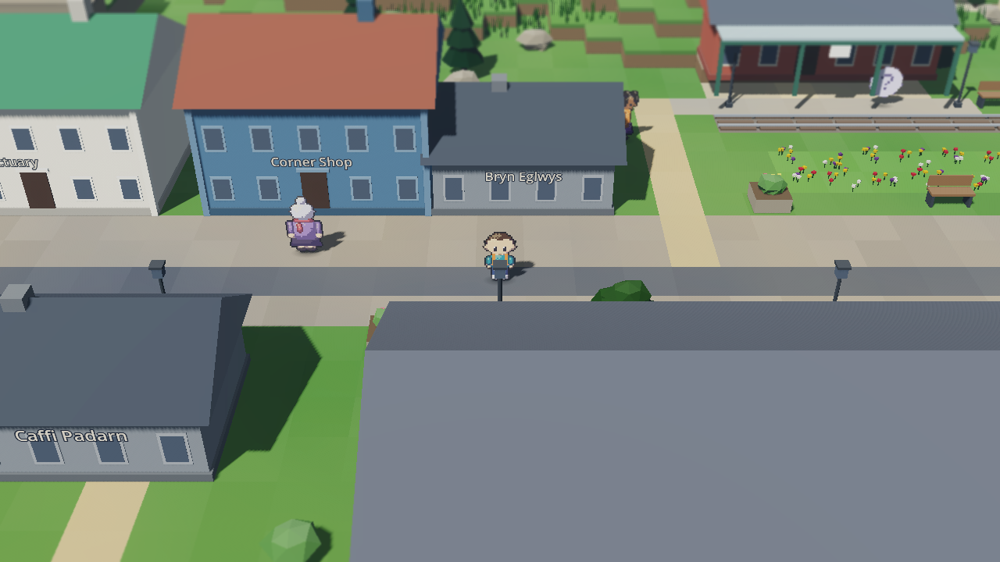
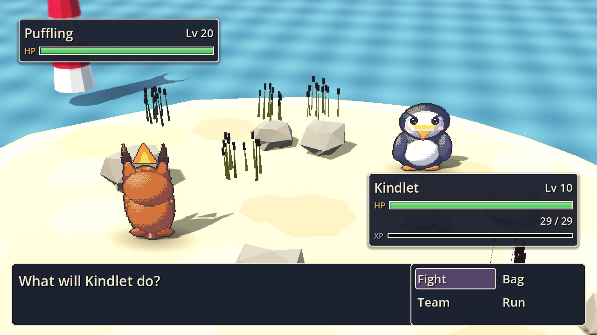
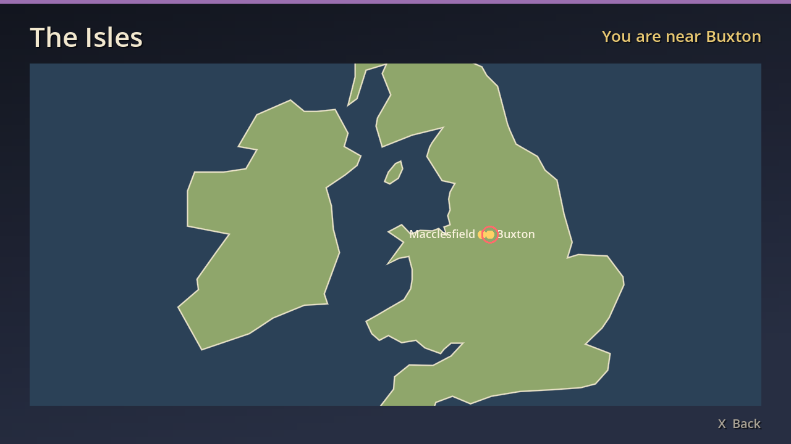
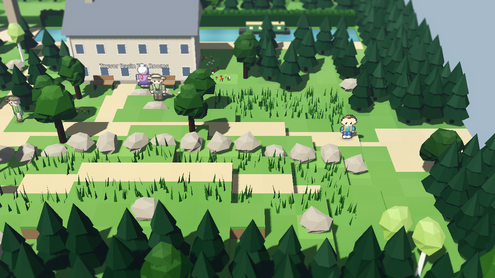
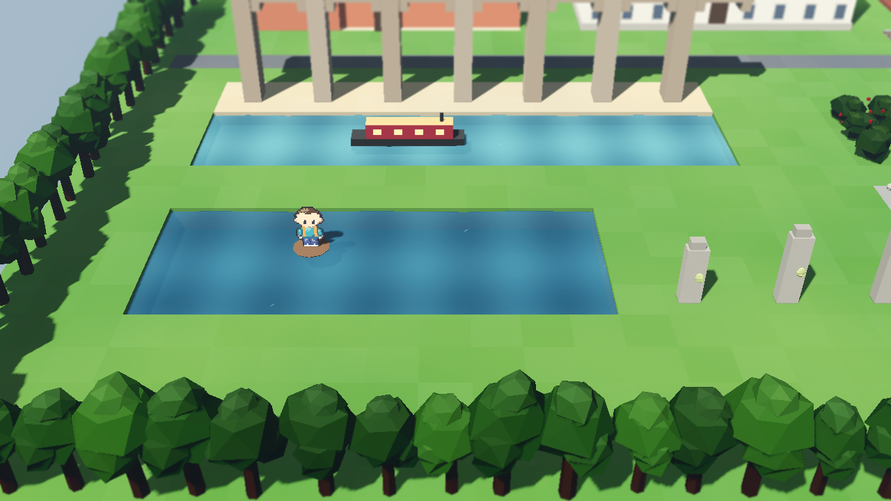

# Wildlore

[](https://github.com/orchardroot/wildlore/actions/workflows/ci.yml)

A monster-catching RPG across the UK and Ireland. You start in Macclesfield, because somebody has to, and the plan is forty towns, ten Keepers and two hundred creatures, most of which you could see on a decent walk if you got up early enough. The rest are legends, and the legends are waking up.


## What's in v0.2, England North and Wales

Carries on from the Buxton spa: north over the Goyt to Manchester, across Chat Moss to Liverpool, down the Wirral to Chester, then into Wales by the Pontcysyllte aqueduct, up Yr Wyddfa, and all the way round the coast to Cardiff. Four Stones now, and the Welsh dragon has woken up, which the Enclosure did not have in its spreadsheet.

- 11 towns and 9 routes, from Macclesfield to Cardiff, plus a ferry to Douglas on the Isle of Man
- 74 creatures: puffins, choughs, red kites, seals, Cardigan Bay dolphins, a peppered moth that changes with the air, mine spirits, the Afanc, and Y Ddraig Goch
- Four Keepers: Maud in Buxton, Ray in a Liverpool club, Eluned in a slate quarry, Rhys under a stormy Cardiff roof
- A bike, and three field abilities (Hedge-lay, Brook-wade in a coracle, Fell-scramble up scree)
- Trains between towns you've visited, a world map drawn from real coastlines, and the Fieldbook will show you where a creature lives
- Three save slots plus autosave, the Ark for spare creatures, and you can finally be called something other than Sam

| | |
|---|---|
|  |  |
|  |  |
|  |  |

## Controls

| Action | Keyboard | Gamepad |
|---|---|---|
| Move | Arrows or WASD | D-pad or left stick |
| Run | Shift (hold) | X / West |
| Confirm / talk | Z, Enter or Space | A / South |
| Back | X or Backspace | B / East |
| Menu | Esc or Tab | Start |
| Bike on / off | B | Y / North |

## Playing it

Grab the Mac or Windows zip from [Releases](../../releases). The builds aren't signed, so on a Mac right-click Wildlore.app and choose Open the first time; on Windows click "More info" then "Run anyway". It runs at 60 fps on my 2013 iMac, Liverpool included, so it'll be fine on yours.

From source: install nothing, run `tools/get_godot.sh` (it fetches the pinned Godot 4.7.2), then open the project with that binary.

## How it's made

Godot 4, GDScript, the Compatibility renderer. Everything is generated: the 3D world is built from text maps by `world/zone_builder.gd`, the creature and character sprites are drawn by `tools/spritegen.gd` from JSON recipes, and the music is composed as note lists in `tools/music/`. No downloaded art or audio.

```
tools/test.sh              # 350-odd unit tests plus the data validator
tools/playtest.sh slice 2  # a headless bot plays the slice and must win the Brook Stone
tools/playtest.sh m2 2     # ...or carries on to Cardiff and must win all four
tools/playtest.sh fuzz 7 600   # random walking, talking and battling, looking for soft-locks
```

CI runs the tests and the bot on every push, and three fuzz runs every night. Design and plans live in `docs/superpowers/`.

## Status

Milestone M2 (England North and Wales) is done. Next: the South of England and a ferry to Ireland. The board is [here](https://github.com/users/orchardroot/projects/2).

*orchardroot, made in Cheshire, under the supervision of two cats. Neither of them is in this one. Yet.*
