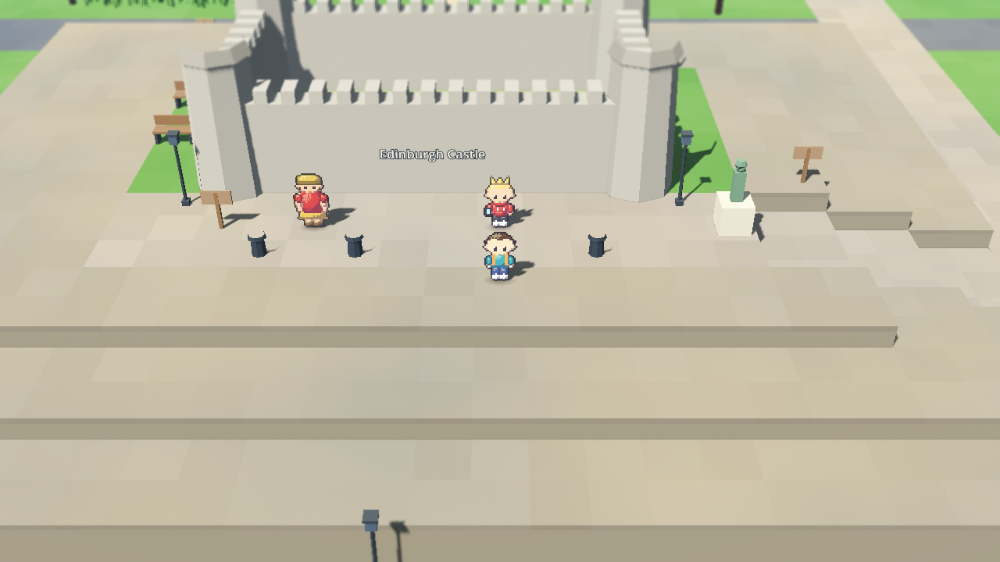
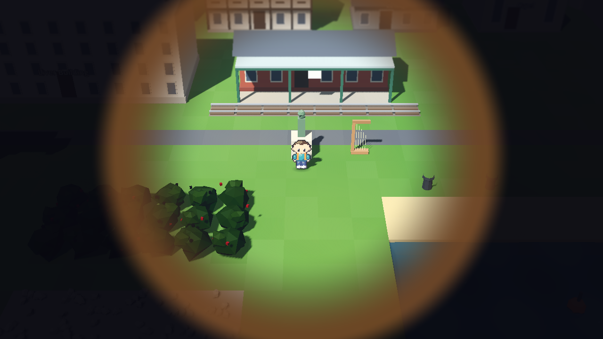
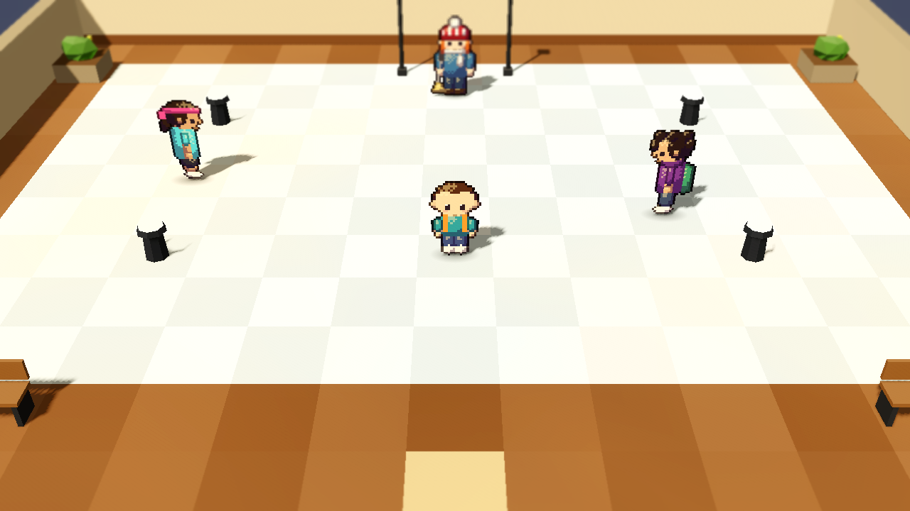

# Wildlore

[](https://github.com/orchardroot/wildlore/actions/workflows/ci.yml)

A monster-catching RPG across the UK and Ireland. You start in Macclesfield, because somebody has to, and the plan is forty towns, ten Keepers and two hundred creatures, most of which you could see on a decent walk if you got up early enough. The rest are legends, and the legends are waking up.


## What's in v0.4, Northern Ireland and Scotland

From Newgrange over the Mournes to Belfast, where the shipyard Keeper keeps the Iron Stone under Samson and Goliath, then up the Antrim coast to the Giant's Causeway, where Lord Vane himself is trying to lease the columns and the sea has opinions about that. Across to Cairnryan, through Glasgow and Edinburgh, into Glencoe and up the Great Glen, where the Enclosure's survey boat on Loch Ness finds rather more than it was looking for. Inverness for the Frost Stone, then Skye, the Cairngorms, Aberdeen, and the boat to Orkney if you fancy it.

- 31 towns and 171 creatures: wildcats, capercaillie, Highland cattle, golden eagles, the Highland midge (sorry), orcas, the Cairngorm reindeer, kelpies, brownies, the Blue Men of the Minch, and three more legends: Manannán's Horse, the Cù-Sìth and Nessie
- Nine Stones: Ruairí in the Belfast shipyard and Isla on the Inverness ice join the seven from before
- The Lantern for dark caves, Bog-cross for the peat, and ferries over the North Channel and out to Kirkwall
- Plus everything from v0.3: the South, Ireland, double battles, and the rest

| | |
|---|---|
|  |  |
|  |  |

## Controls

| Action | Keyboard | Gamepad |
|---|---|---|
| Move | Arrows or WASD | D-pad or left stick |
| Run | Shift (hold) | X / West |
| Confirm / talk | Z, Enter or Space | A / South |
| Back | X or Backspace | B / East |
| Menu | Esc or Tab | Start |
| Bike on / off | B | Y / North |

## Playing it

Grab the Mac or Windows zip from [Releases](../../releases). The builds aren't signed, so on a Mac right-click Wildlore.app and choose Open the first time; on Windows click "More info" then "Run anyway". It runs at 60 fps on my 2013 iMac, Liverpool included, so it'll be fine on yours.

From source: install nothing, run `tools/get_godot.sh` (it fetches the pinned Godot 4.7.2), then open the project with that binary.

## How it's made

Godot 4, GDScript, the Compatibility renderer. Everything is generated: the 3D world is built from text maps by `world/zone_builder.gd`, the creature and character sprites are drawn by `tools/spritegen.gd` from JSON recipes, and the music is composed as note lists in `tools/music/`. No downloaded art or audio.

```
tools/test.sh              # 440-odd unit tests plus the data validator
tools/playtest.sh slice 2  # a headless bot plays the slice and must win the Brook Stone
tools/playtest.sh m2 2     # ...or carries on to Cardiff and must win all four
tools/playtest.sh fuzz 7 600   # random walking, talking and battling, looking for soft-locks
```

CI runs the tests and the bot on every push, and three fuzz runs every night. Design and plans live in `docs/superpowers/`.

## Status

Northern Ireland and Scotland are done. Next: down the east side of England to York, the Moot at Stonehenge, and London. The board is [here](https://github.com/users/orchardroot/projects/2).

*orchardroot, made in Cheshire, under the supervision of two cats. Neither of them is in this one. Yet.*
