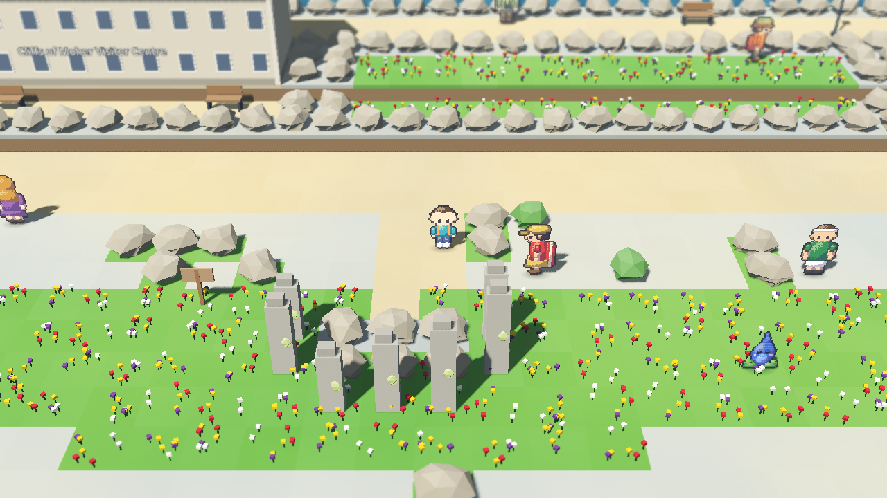
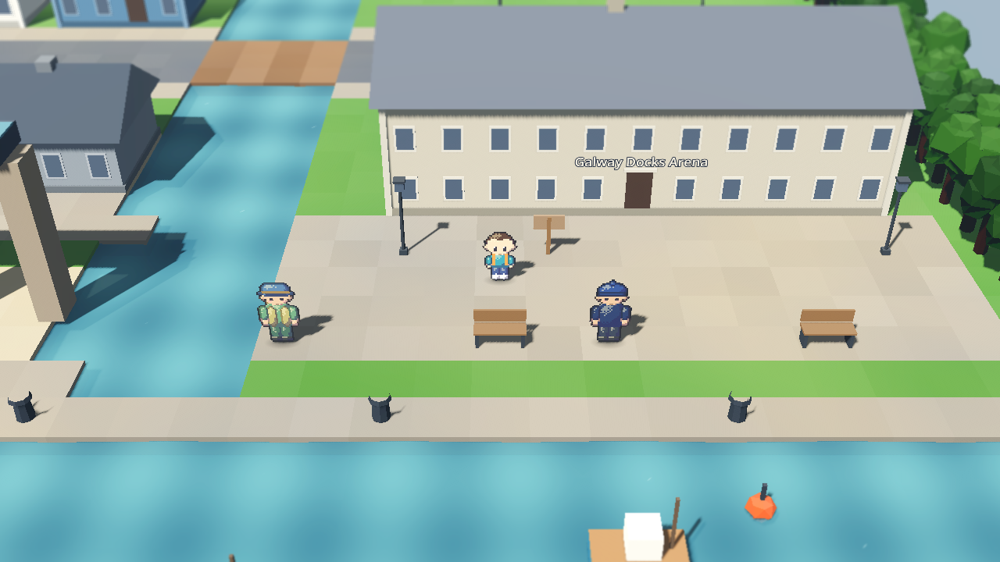
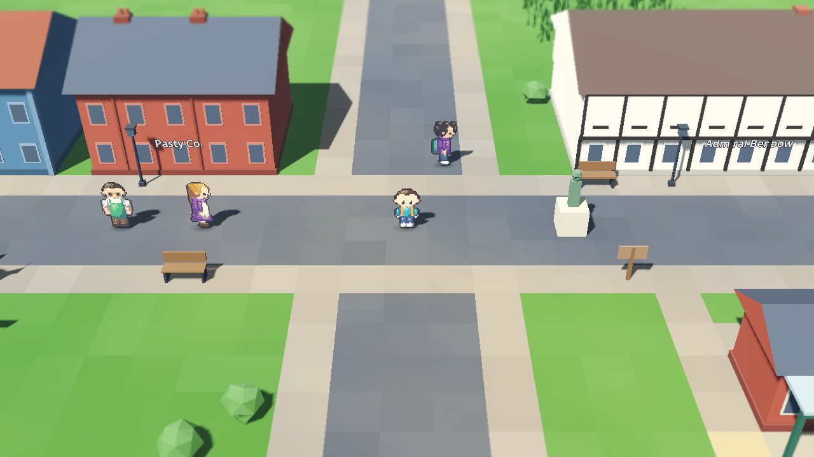
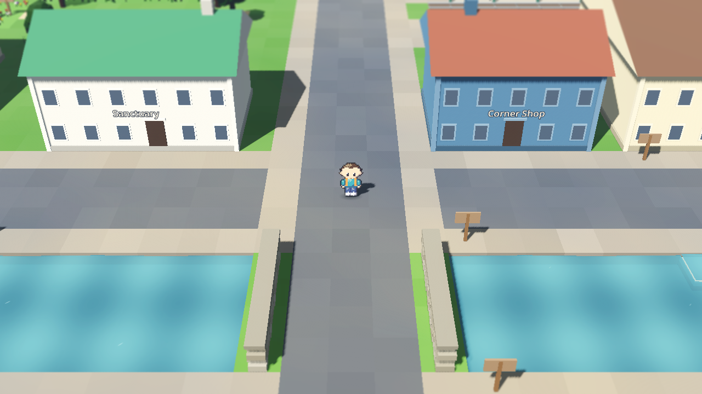

# Wildlore

[](https://github.com/orchardroot/wildlore/actions/workflows/ci.yml)

A monster-catching RPG across the UK and Ireland. You start in Macclesfield, because somebody has to, and the plan is forty towns, ten Keepers and two hundred creatures, most of which you could see on a decent walk if you got up early enough. The rest are legends, and the legends are waking up.


## What's in v0.3, the South and Ireland

On from Cardiff: over the Severn to Bath, up the Tor at Glastonbury, across Dartmoor to Tintagel and down into a Cornish tin mine at Penzance. Then the train back north, over the Menai Bridge to Holyhead, and the ferry to Dublin. From there it's round Ireland the long way: Wicklow, Kilkenny, Cork, Kerry, Dingle, the Burren, Galway, Connemara and Sligo, ending at Newgrange on the morning of the solstice, which the Enclosure has booked for a private event. It goes about as well as you'd expect.

- 21 towns now, and 130 creatures: dormice, cranes, basking sharks, Arctic terns, the Kerry slug, piskies, the púca, selkies, and two more legends, the Green Man and the Morrígan
- Seven Stones: Morwen on Glastonbury Tor, Declan in Dublin and Nuala on the Galway docks join the first four
- Double battles, for the trainers who come in pairs
- Trains that know they can't cross the Irish Sea, and a ferry that can
- Plus everything from v0.2: England North and Wales, the bike, field abilities, save slots, the Ark, the world map

| | |
|---|---|
|  |  |
|  |  |
|  |  |

## Controls

| Action | Keyboard | Gamepad |
|---|---|---|
| Move | Arrows or WASD | D-pad or left stick |
| Run | Shift (hold) | X / West |
| Confirm / talk | Z, Enter or Space | A / South |
| Back | X or Backspace | B / East |
| Menu | Esc or Tab | Start |
| Bike on / off | B | Y / North |

## Playing it

Grab the Mac or Windows zip from [Releases](../../releases). The builds aren't signed, so on a Mac right-click Wildlore.app and choose Open the first time; on Windows click "More info" then "Run anyway". It runs at 60 fps on my 2013 iMac, Liverpool included, so it'll be fine on yours.

From source: install nothing, run `tools/get_godot.sh` (it fetches the pinned Godot 4.7.2), then open the project with that binary.

## How it's made

Godot 4, GDScript, the Compatibility renderer. Everything is generated: the 3D world is built from text maps by `world/zone_builder.gd`, the creature and character sprites are drawn by `tools/spritegen.gd` from JSON recipes, and the music is composed as note lists in `tools/music/`. No downloaded art or audio.

```
tools/test.sh              # 400-odd unit tests plus the data validator
tools/playtest.sh slice 2  # a headless bot plays the slice and must win the Brook Stone
tools/playtest.sh m2 2     # ...or carries on to Cardiff and must win all four
tools/playtest.sh fuzz 7 600   # random walking, talking and battling, looking for soft-locks
```

CI runs the tests and the bot on every push, and three fuzz runs every night. Design and plans live in `docs/superpowers/`.

## Status

Milestone M3 (the South and Ireland) is done. Next: Northern Ireland, Scotland, the Moot at Stonehenge and London. The board is [here](https://github.com/users/orchardroot/projects/2).

*orchardroot, made in Cheshire, under the supervision of two cats. Neither of them is in this one. Yet.*
