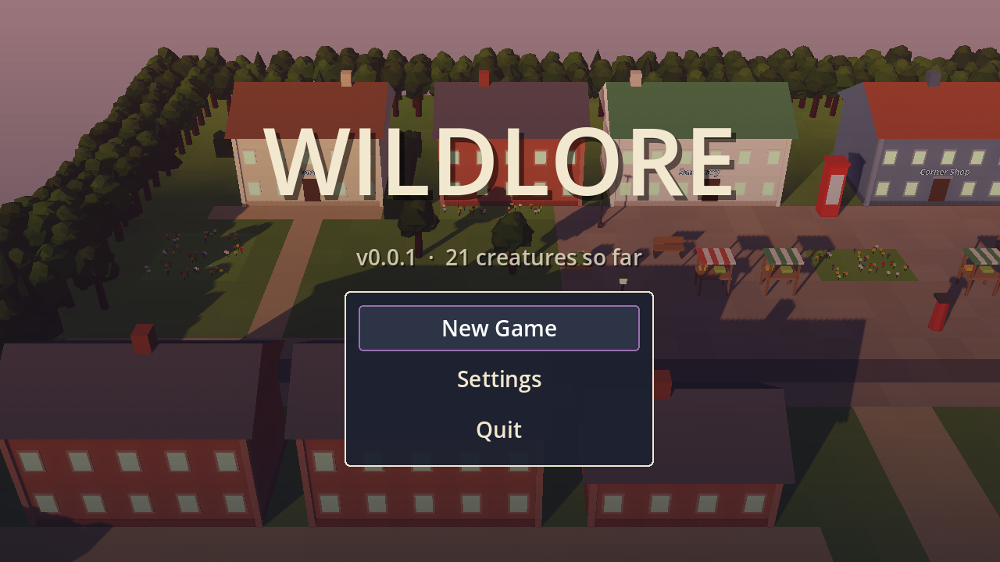
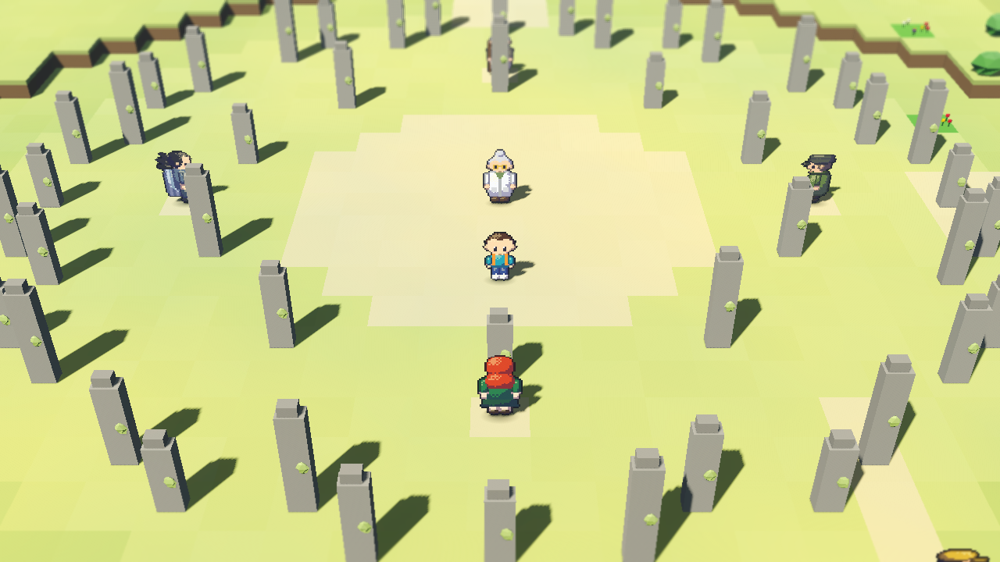
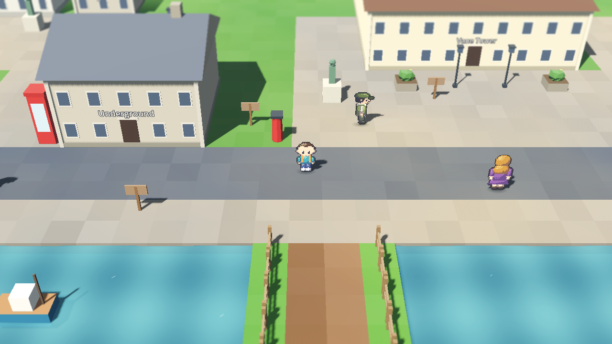
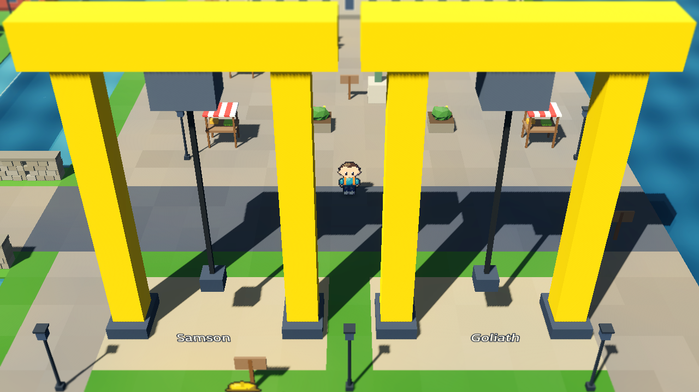
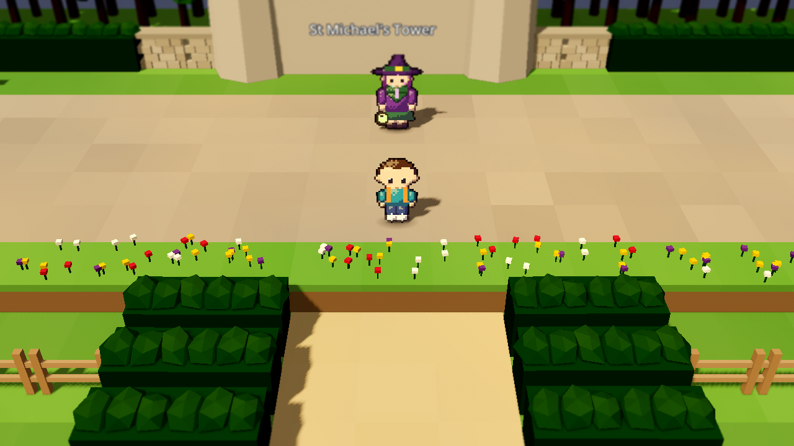
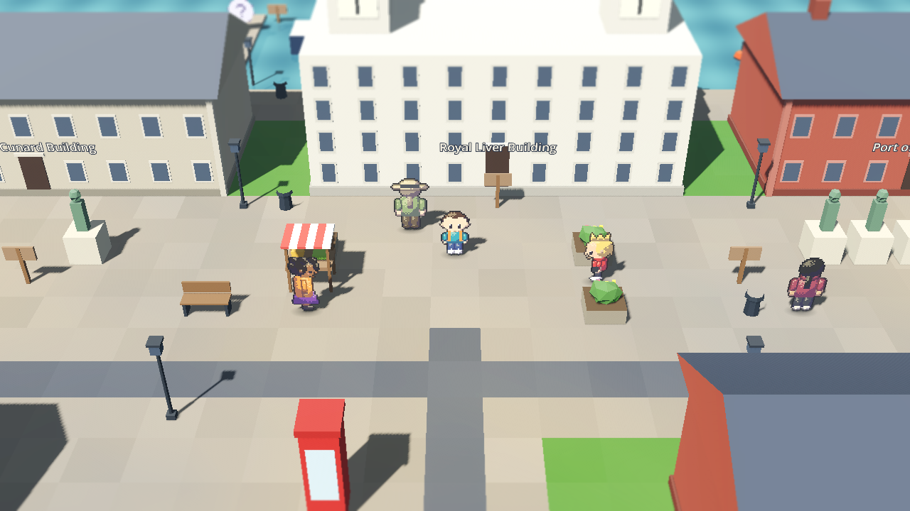
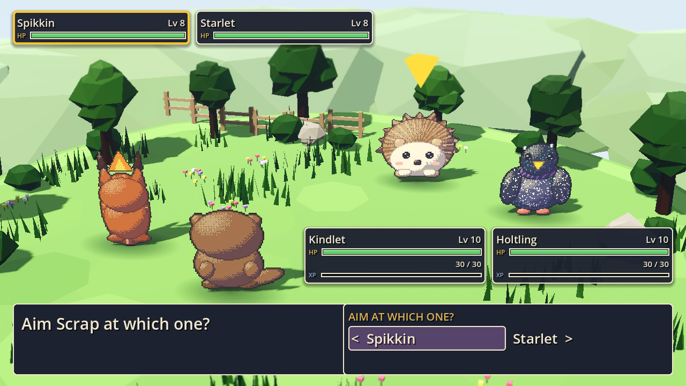

# Wildlore

[](https://github.com/orchardroot/wildlore/actions/workflows/ci.yml)

A monster-catching RPG across the UK and Ireland. You start in Macclesfield, because somebody has to, and the plan is forty towns, ten Keepers and two hundred creatures, most of which you could see on a decent walk if you got up early enough. The rest are legends, and the legends are waking up.



## What's in 2.1

All of it, start to finish, and then some. You leave home in Macclesfield with a hedgehog, a squirrel or an otter, and you walk (and cycle, and take the train, and catch the odd ferry) all the way round England, Wales, Scotland, Northern Ireland, Ireland and the Isle of Man, collecting ten Stones from ten Keepers while a heritage company with very good lanyards tries to buy the countryside. Then you go to Stonehenge for the Moot, find out who the Champion has been all along, and go to London to have a word with Lord Vane about his tower.

- 40 towns, from Macclesfield to Kirkwall, Penzance to Derry~Londonderry
- 200 creatures, every one with a real fact about the animal or the legend it's based on, and all ten legends: Y Ddraig Goch, the Green Man, the Morrígan, Manannán's Horse, the Cù-Sìth, Nessie, Black Shuck, the Lambton Worm, Herne the Hunter and Bran's Raven
- Ten Keepers, the Four Winds, a Champion, a rival who turns out to be the best mate you've got, and a villain who complains about his deposit
- A bike, a coracle, a lantern, a pair of waders, trains, ferries, and eventually a raven to fly you anywhere you've been
- Double battles, British weather that matters, day and night, three save slots and an Ark for the spares
- Folk-ish music and sound effects, all synthesised from scratch, and pixel art and buildings all generated from code
- A post-game: the Keepers, the Professor and your rival want rematches (once a day, they have lives), two secrets that only come out after dark or after the credits, and a diploma if you fill the Fieldbook
- About 500 buildings you can walk into: every landmark from the John Rylands Library to the Tower of London has someone inside who'll tell you something true about it, and every town has a few front doors open for a cuppa and a bit of local dialect
- Railways that go somewhere: trains actually run (into termini, through tunnels, off over the horizon) and the level crossing barriers come down for them
- A world that's actually alive: surf and gulls, birdsong, rain on the roof, footsteps that change with the ground, trains you can hear coming; weather that hangs about properly, chimney smoke, bobbing boats, lamplight pooling on the pavement, bunting, washing lines, and creatures rustling about in the long grass. Townsfolk notice the drizzle, some go home at night, and the lamplighter comes out
- Journeys you can watch: the train pulls in and you get the window seat (with a cup of tea), the ferry crosses with the gulls, and the Raven gives you a lift over the map. Skippable, obviously
- Every creature has its own cry, Keepers get a proper VS card, doors actually open, and the map tells you what's in each town and flies you there
- Folk say hello like they mean it: Ey up, Shwmae, Bout ye, Alright la
- Proper furniture in every room: fireplaces, rugs, a fryer in the chippy, pictures on the walls
- Kinder to your thumbs: speed up battles and text, "super effective" tags once you know a creature, plain-English move descriptions, a "Where next?" hint, the Ark from the pause menu, nicknames, a move relearner in every Sanctuary, a Lavender Sachet to keep the riff-raff away, and button prompts that match your controller
- The Team Thermos, a flask big enough for the whole team: switch it on and the ones on the bench learn from every win too
- Your lead creature walks along behind you, and has opinions about the weather if you ask it
- The seasons follow the real calendar: the trees turn in autumn and blossom in spring, there are pumpkins on doorsteps at Halloween, fireworks for Bonfire Night, and a tree in the square at Christmas
- A wireless in the front room reads the Shipping Forecast, off the game's own weather, so it's actually useful. And a blue plaque in every town, because somebody famous lived everywhere
- Pub quizzes in nine pubs, a hundred and fifty questions, and a prize once a day if you're sharp. Phones away
- Photo mode (P, or click the right stick) and a Stats page that counts your steps, your trains and your cups of tea
- The Hedgerow Year: forage blackberries, sloes, mushrooms and seaweed along every route (what you find depends on the season and the weather), then cook them up in Mum's kitchen. Gran's recipe book gets you started, and folk all over the isles will teach you the rest
- Folk charms to hold: a hag stone, a horseshoe, St Brigid's cross, a sprig of rowan and more, each with a small effect in battle. Craft them, find them, buy a few, or catch a creature that's already carrying one
- Friendship you can see: hearts on the summary, and a creature that loves you will shake off a status or hang on at 1 HP for you. A few evolve early if the bond is strong enough
- A Rumours page in the Fieldbook (a bloke in the pub has seen something in the fog at dusk), Professor Garside's rewards as your Fieldbook fills up, region stamps, and a Visitor's Book for every room you've walked into
- Today's Walk on the wireless: a creature that's out in numbers, a pub with a doubled quiz prize and a weather bounty, new every real day. No streaks, nothing lost if you miss one. Rematches and quiz prizes now reset by the real date
- Proper signs on the buildings: painted shop fascias, pub signs on brackets, enamel station boards, carved stone over the museums, and the name of the place pops up when you're at its door
- A gentler climb in the middle: more trainers before the two big jumps in level, and the Team Thermos now shares three-quarters of the XP
- **2.0, Common Ground.** The Enclosure spent the whole game fencing the land off. Now you get stuck in:
  - Rewilding: six damaged places, one in each nation (a drained moss in the Peak, a clear-fell in Snowdonia, an overgrazed glen, a choked river, a cutaway bog and a scraped bank on the Isle of Man). Help the warden and the place changes in front of you, stage by stage, until the creatures that left come back
  - A parish noticeboard in every town, with daily jobs (count the bats after dark, find some blackberries, no questions asked). Jobs earn standing with England, Wales, Scotland, Northern Ireland, Ireland and the Isle of Man, and standing gets you a discount, extra stock, a parcel from the landlord, and the locals knowing your name
  - Battles with more to think about: call the weather yourself (Call the Clouds, Proper Downpour, The Haar, Beast from the East, Bank Holiday Sun), drain, recoil, flurries, Batten Down, and a knack for every creature line, like Thick Fleece, Stiff Upper Lip and Moaner
  - Uncommon coats: about one wild creature in a hundred turns up in a seasonal coat, winter white, autumn russet, summer gold, spring green, storm dark or moonlit silver
  - Home: a trophy shelf at Mum's that fills up as you go, a garden out front to grow your forage in, and the legends you've caught dropping by
  - County Shows: a different one each real day (the Cheshire, the Royal Welsh, the Great Yorkshire, the Royal Highland, Balmoral and the Ploughing), with a marquee, a ring, a rule of the day and rosettes to spend. After the credits, the Open Moot at Stonehenge, five fights straight, as often as you like
  - Post from Kit: sixteen postcards waiting at post boxes as the story goes on, and every Keeper (and a few Enclosure Directors, who are trying their best) has a little side story once you've moved on
  - Every menu fits its frame now, even if you call your creature something long
- **2.1, First Impressions.** The depth was there; now you can see it:
  - A cold open on a moonlit moor, Mum and Garside pointing you at the noticeboard and the garden, a first job you can do in the Forest, and an "Around here" line on the pause card for jobs, shows, rewilding and side stories
  - Keepers fight like bosses: their own movesets, a held charm, a trick that suits the place, and a cup of tea for the ace. Maud's spa is dressed for a swimming gala
  - Battles you can read: the weather plate says what the weather does, moves say when they're stronger, stat changes and crits show up, snares give you honest odds, and the wobbles are real
  - Moves look and sound like what they are (beams, bolts, clouds, drains, a sky that changes when you call the weather), twelve new attack sounds, and longer tunes for the first hour
  - The wild changes with the real seasons: spring fledglings, summer swifts and glow-worms, autumn starlings over Chat Moss, winter snow buntings, and adders and bats that sleep through winter. The Rumours page tells you when
  - Each starter has a knack and a signature move of its own, evolved creatures are properly stronger, and wild creatures sometimes leave a bit of forage behind
  - The Cat and Fiddle moor has gritstone edges and heather now, and the Field Station has the owl and a kettle
- Options for the rest of us: every key and button can be remapped, type symbols as well as colours, a colour-blind palette, instant text, and a setting to calm the flashing down

| | |
|---|---|
|  |  |
|  |  |
|  |  |

## Controls

| Action | Keyboard | Gamepad |
|---|---|---|
| Move | Arrows or WASD | D-pad or left stick |
| Run | Shift (hold) | X / West |
| Confirm / talk | Z, Enter or Space | A / South |
| Back | X or Backspace | B / East |
| Menu | Esc or Tab | Start |
| Bike on / off | B | Y / North |
| Fly (after the Moot) | F | Back / Select |
| Photo mode | P | Right stick click |

All of it can be rebound under Settings, Controls. Confirm and Back can't be swapped onto the same key, because I've seen what happens.

## Playing it

Grab the Mac or Windows zip from [Releases](../../releases). The builds aren't signed, so on a Mac right-click Wildlore.app and choose Open the first time; on Windows click "More info" then "Run anyway". It runs at 60 fps on my 2013 iMac, Liverpool included, so it'll be fine on yours.

From source: install nothing, run `tools/get_godot.sh` (it fetches the pinned Godot 4.7.2), then open the project with that binary.

## How it's made

Godot 4, GDScript, the Compatibility renderer. Everything is generated: the 3D world is built from text maps by `world/zone_builder.gd`, the creature and character sprites are drawn by `tools/spritegen.gd` from JSON recipes, and the music is composed as note lists in `tools/music/`. No downloaded art or audio.

```
tools/test.sh              # over 500 unit tests plus the data validator
tools/playtest.sh slice 2  # a headless bot plays the slice and must win the Brook Stone
tools/playtest.sh m2 2     # ...or carries on to Cardiff and must win all four
tools/playtest.sh fuzz 7 600   # random walking, talking and battling, looking for soft-locks
tools/playtest.sh full 1   # the whole story, Macclesfield to the credits (about 20 minutes)
```

CI runs the tests and the bot on every push, and three fuzz runs every night. Design and plans live in `docs/superpowers/`.

## Status

Done. 1.0 is the whole game, polished, levelled and play-tested by a robot that walked from Macclesfield to London and found three places it could get stuck (it can't any more). If you find a fourth, the issues page is [here](../../issues). The board is [here](https://github.com/users/orchardroot/projects/2).

*orchardroot, made in Cheshire, under the supervision of two cats. Neither of them is in this one. Yet.*
